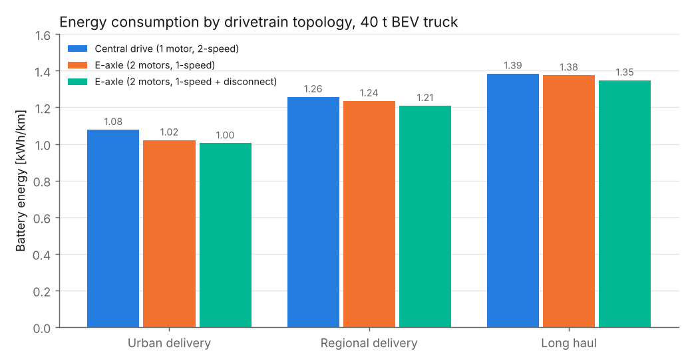
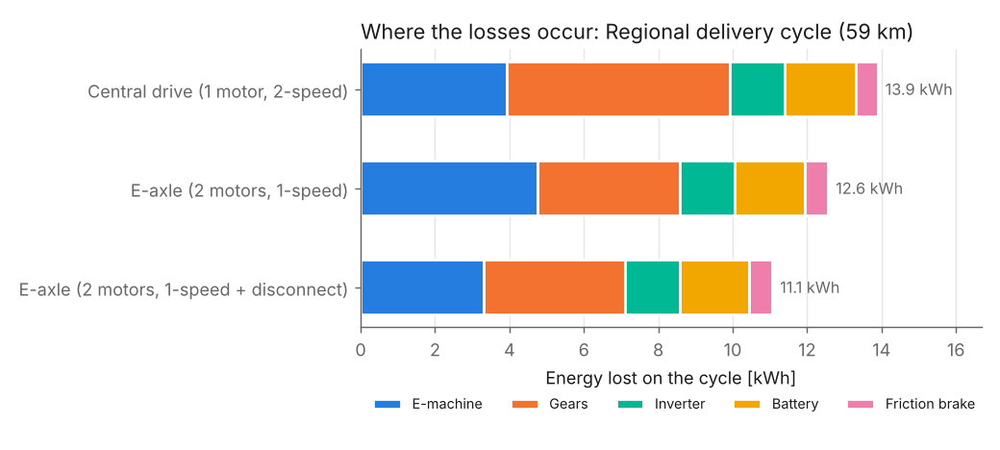
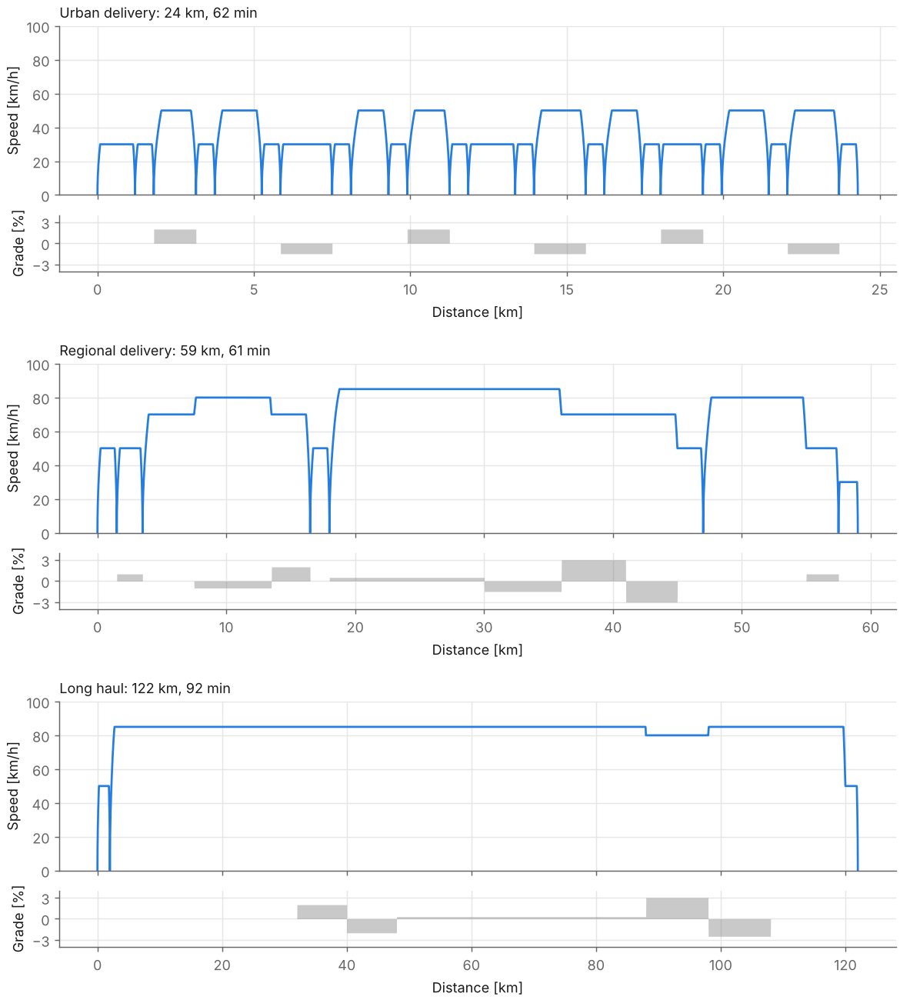
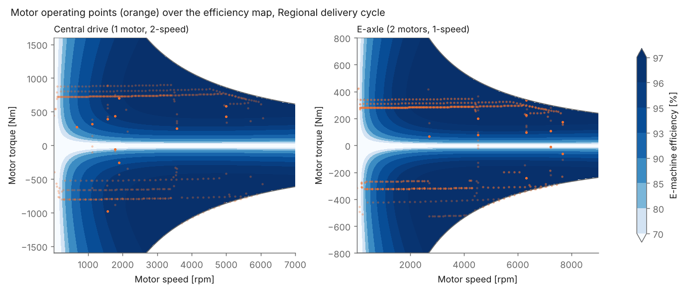

# Drivetrain topology study for a 40 t battery-electric truck

A longitudinal vehicle simulation in Python. It compares the energy consumption of two
drivetrain layouts for a heavy-duty battery-electric truck (BEV) over three drive cycles:

| Layout | Machines | Transmission |
|---|---|---|
| **Central drive** | 1 × 450 kW, 1,600 Nm | 2-speed gearbox + rear-axle differential |
| **E-axle** | 2 × 225 kW, 800 Nm | single-speed reduction per motor, integrated in the axle |
| **E-axle + disconnect** | as above | the idle motor can be decoupled |

Both layouts have the same peak power, so the study isolates the effect of the layout and its
operating strategy.

## Key results



| Topology | Urban delivery | Regional delivery | Long haul |
|---|---:|---:|---:|
| Central drive (1 motor, 2-speed) | 1.078 kWh/km | 1.257 kWh/km | 1.385 kWh/km |
| E-axle (2 motors, 1-speed) | 1.021 (−5.3 %) | 1.235 (−1.8 %) | 1.376 (−0.6 %) |
| E-axle + disconnect | 1.004 (−6.9 %) | 1.209 (−3.8 %) | 1.348 (−2.7 %) |

Findings:

1. **The e-axle advantage is largest in urban delivery and shrinks at constant motorway speed.**
   With frequent low-load operation, running on one of two smaller motors keeps the operating
   point in a more efficient region.
2. **Most of the advantage comes from the assumed gear efficiency, not from the motors.**
   With the same gear efficiency in both layouts, the central drive is *better* on the regional
   (1.257 vs 1.273 kWh/km) and long-haul (1.385 vs 1.412 kWh/km) cycles
   (`results/sensitivity_gear_efficiency.csv`). The comparison is only as good as the
   transmission efficiency data, and this would be the first thing to measure or model in detail.
3. **Drag from the idle motor matters.** On the motorway, the unpowered second motor still spins
   and causes iron and windage losses. A disconnect clutch removes about 3.3 kWh of motor losses
   on the 122 km long-haul cycle (−2 % consumption).



## Method

Backward-facing, quasi-static simulation at 1 s steps, the same approach used by the
EU certification tool VECTO.

1. **Drive cycle**: target speed and road grade are defined over distance (VECTO-style
   mission profile). A driver model limits acceleration (0.4 m/s², and power-limited uphill)
   and deceleration (0.6 m/s²), then resamples to time. See `truck_sim/cycle.py`.
2. **Road loads**: F = m(1+e)a + ½ρc<sub>d</sub>Av² + mg·c<sub>r</sub>·cos θ + mg·sin θ,
   with m = 40 t, c<sub>d</sub>A = 0.50 × 10 m², c<sub>r</sub> = 0.005. See `truck_sim/vehicle.py`.
3. **Drivetrain**: wheel torque and speed are mapped through gears (constant efficiency) to the
   e-machine(s). E-machine losses use an analytical model with copper, iron, friction/windage
   and constant terms; the inverter uses a proportional + constant loss model.
   See `truck_sim/components.py`.
4. **Operating strategy**: at every step the model picks the option with the lowest DC power:
   the gear (central drive) or single vs shared motor operation (e-axle). See `truck_sim/topologies.py`.
5. **Battery**: 600 kWh pack, open-circuit voltage + internal resistance model, 400 kW charge
   limit; braking power beyond motor or battery limits goes to the friction brakes.
6. **Validation checks** (`tests/`): the energy balance closes within 0.5 % (battery energy =
   wheel energy + all losses + auxiliaries); consumption falls in the published range for 40 t
   BEV trucks; the driver model respects acceleration limits.





## Limitations

These matter for interpreting the numbers, and they are the obvious next steps:

- **Synthetic drive cycles.** The cycles are VECTO-style but not the official ones. Replace them
  with the official VECTO mission profiles (Urban Delivery, Regional Delivery, Long Haul) for
  results comparable with the literature.
- **Generic component models.** The motor efficiency map is analytical and fairly optimistic at
  low load; gear efficiency is constant. Measured or FEM-based maps, and load-dependent gear
  losses, would change the result (see finding 2).
- **Ideal operating strategy.** Gear choice and torque split are re-optimised every second with
  no shift time, hysteresis or clutch losses.
- **No thermal model.** Losses are not linked to component temperatures, and derating is ignored.
- **Recuperation is idealised.** Close to 100 % of braking energy goes through the motors;
  real trucks are limited by axle load, stability control and brake blending.

## Next steps

- [ ] Import official VECTO cycles and published vehicle data
- [ ] Load-dependent gear losses (Coulomb + viscous) and real e-machine maps
- [ ] Shift and torque-split strategy with hysteresis and shift losses
- [ ] Lumped thermal model for e-machine and inverter (derating on long climbs)
- [ ] Off-highway duty cycle (e.g. wheel loader or tractor) with PTO load

## Run it

```bash
pip install -r requirements.txt
python run_study.py        # writes results/ (tables + figures)
python -m pytest tests     # model sanity checks
```

## Project structure

```
truck_sim/
  vehicle.py      road-load model and vehicle parameters
  components.py   e-machine, inverter, gear stage, battery
  topologies.py   central drive and dual-motor e-axle with operating strategies
  cycle.py        distance-based drive-cycle generator
  simulate.py     backward-facing quasi-static simulation loop
run_study.py      comparison study, sensitivity analysis and figures
tests/            energy-balance and plausibility checks
```
